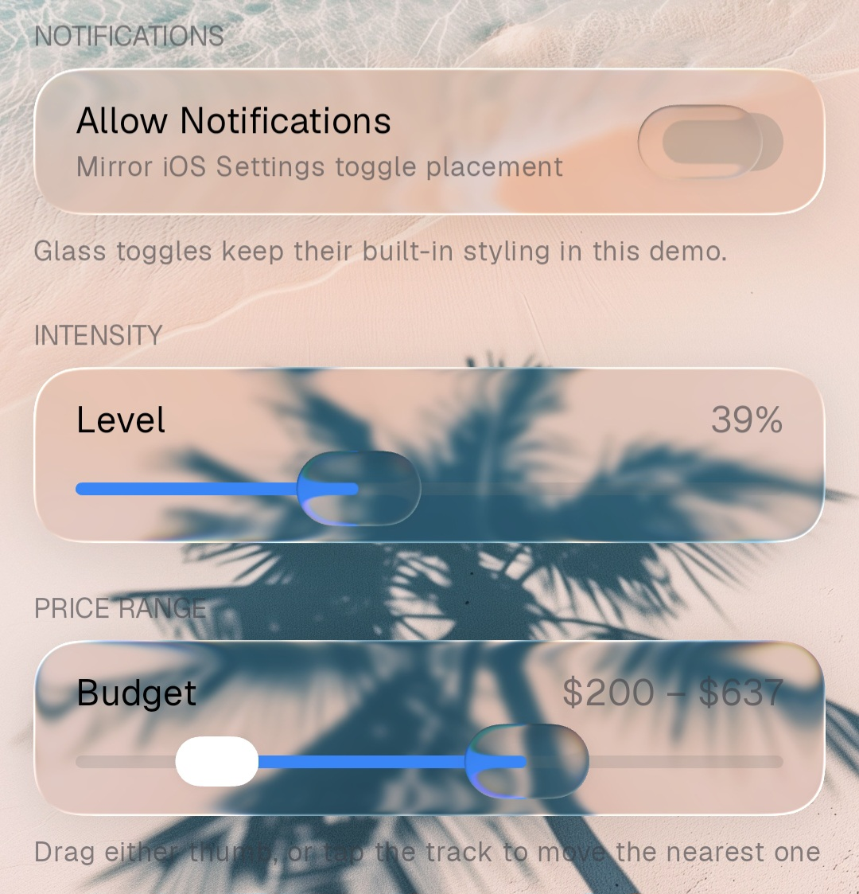
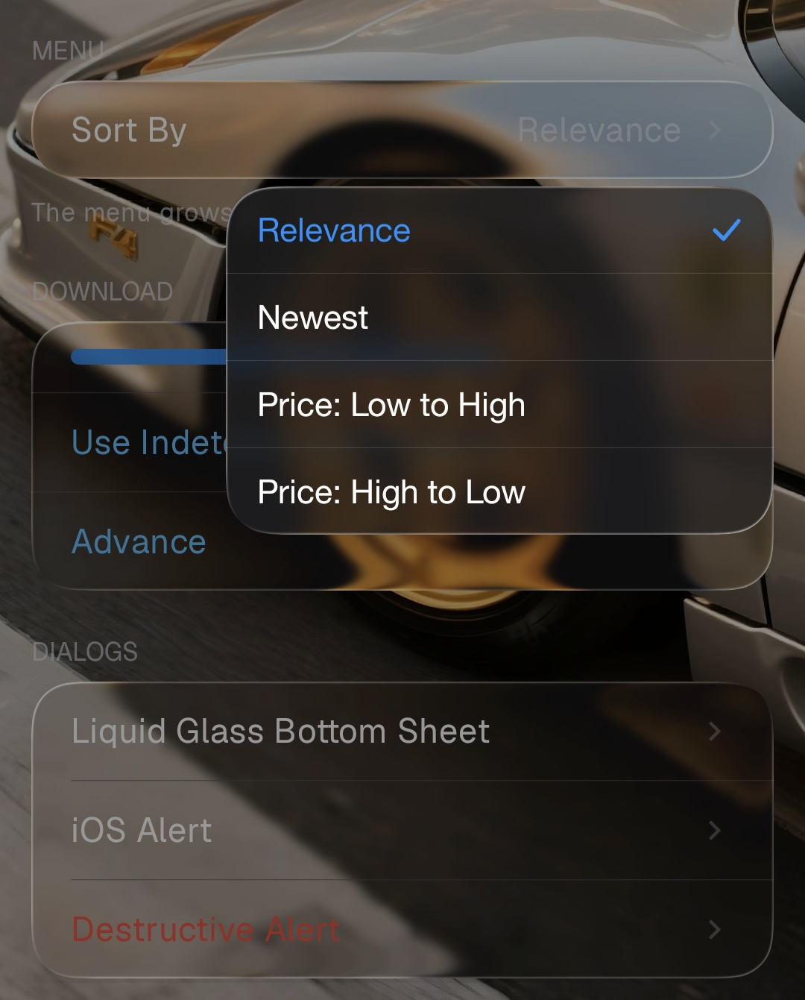
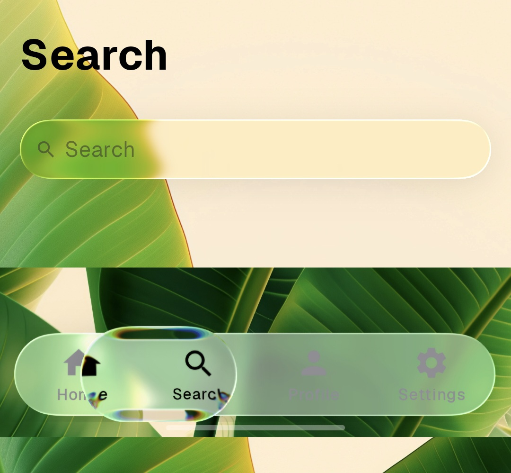
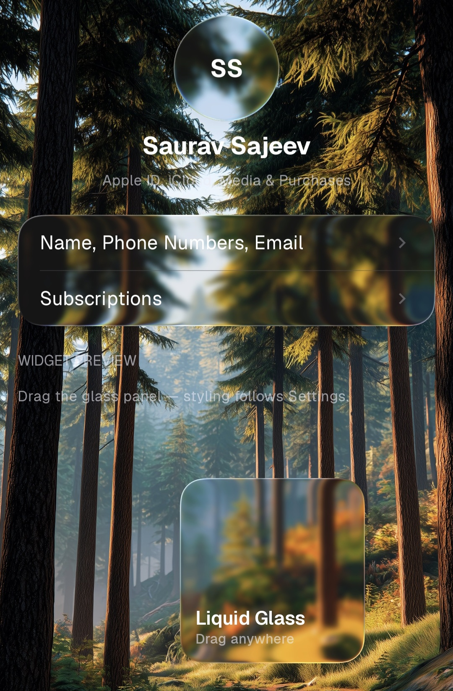
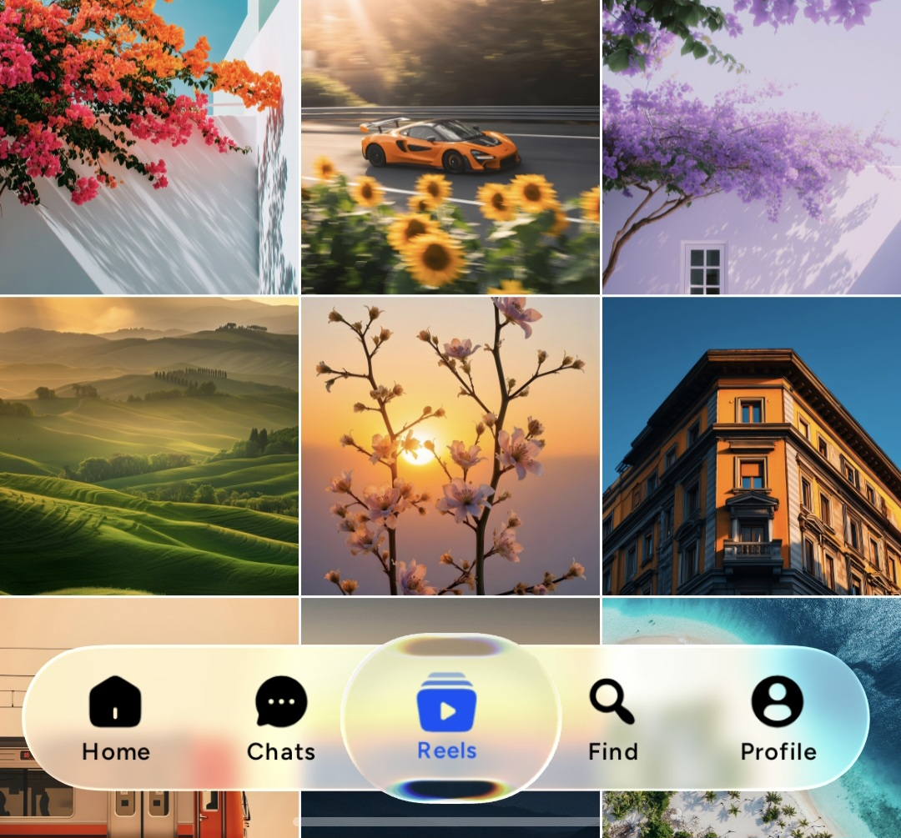
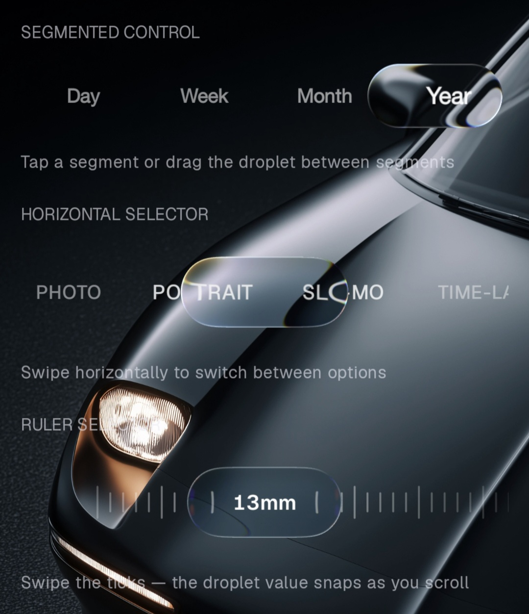
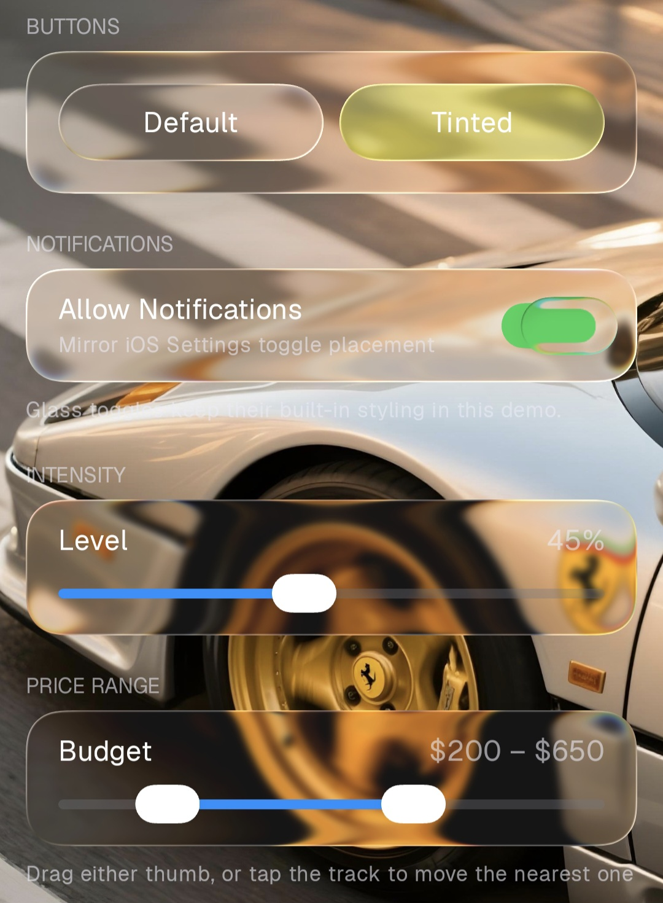
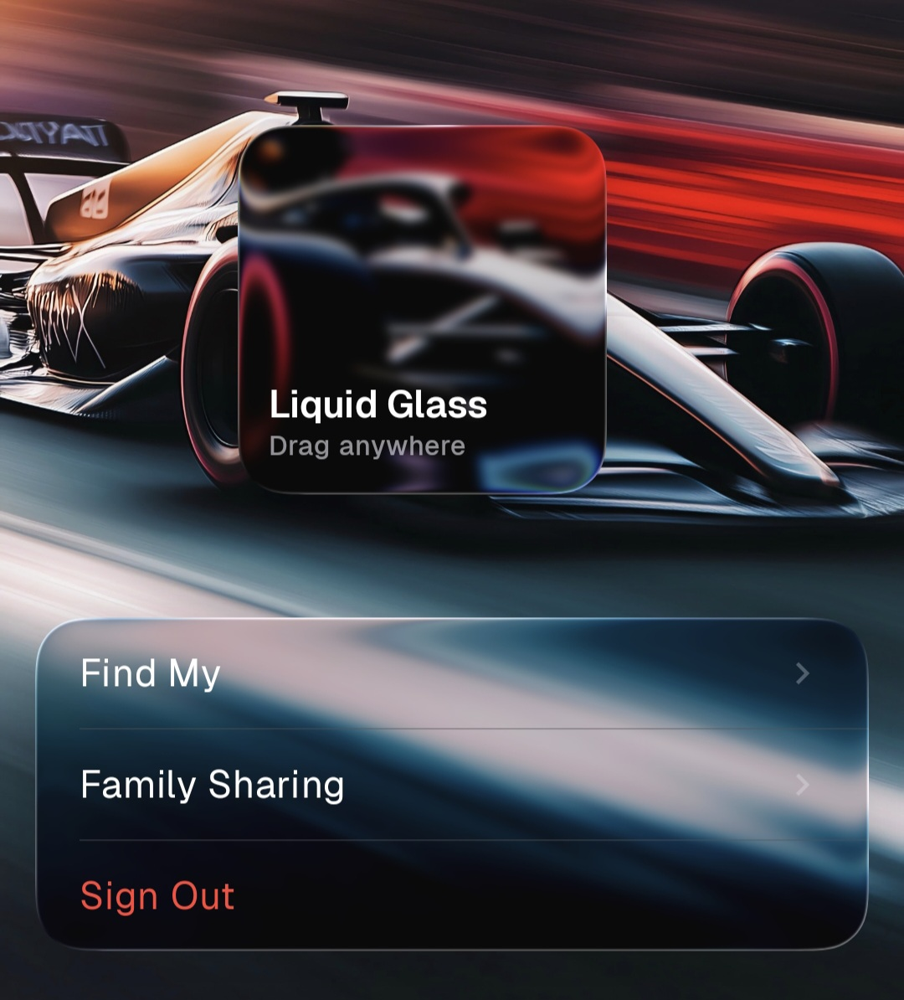

# Prismal - Liquid Glass for Android (Jetpack)

**High Performance Liquid glass for Jetpack Compose** : backdrop sampling, blur, edge refraction, specular highlights, and interactive glass controls with automatic degradation on older Android versions.

[Download Demo App](https://pub-3b102de89d7542a8bfd005af12dd955c.r2.dev/PrismalAGSL%20Demo%20v1.0.7.apk)

[](https://jitpack.io/#styropyr0/PrismalAGSL)
[](LICENSE)
[](https://developer.android.com/about/versions/nougat)
[](https://developer.android.com/jetpack/compose)

Prismal brings an iOS-style liquid glass look to Android Compose apps. Glass surfaces sample live content behind them, refract it at the edges, and respond to touch with spring physics and press ripples. On devices that cannot run AGSL shaders or `RenderEffect`, the library falls back gracefully so you ship one API everywhere.

> **Successor to [Prismal (OpenGL ES)](https://github.com/styropyr0/Prismal)**  
> The original [styropyr0/Prismal](https://github.com/styropyr0/Prismal) library is still available. It targets the View system and renders glass effects with **OpenGL ES**. This repo (**PrismalAGSL**) is the Compose reimplementation: same visual language and component ideas, rebuilt on **AGSL**, `RenderEffect`, and Compose-first APIs. Use the original if you need OpenGL ES on Views; use this library for Jetpack Compose.

## Screenshots

|                                                                      |                                                                                                                 |
|:--------------------------------------------------------------------:|:---------------------------------------------------------------------------------------------------------------:|
|                       Browse — toggle & slider                       |                                                Prismal Dropdown                                                 |
|  |                                               |
|                              Search tab                              |                                                   Profile tab                                                   |
|                            |                                                                     |
|                             Bottom tabs                              |                         Horizontal Scroll Selector, Segmented Control & Ruler Selector                          |
|                |  |
|                            Widget preview                            |                                           Widget preview — refraction                                           |
|                |                                     |

---

## Table of contents

- [Screenshots](#screenshots)
- [Relation to Prismal (OpenGL ES)](#relation-to-prismal-opengl-es)
- [Features](#features)
- [Platform tiers](#platform-tiers)
- [Requirements](#requirements)
- [Installation](#installation)
- [Quick start](#quick-start)
- [Core concepts](#core-concepts)
- [Built-in components](#built-in-components)
- [Custom glass surfaces](#custom-glass-surfaces)
- [Effects API](#effects-api)
- [Shapes](#shapes)
- [Adaptive luminance](#adaptive-luminance)
- [Interactive primitives](#interactive-primitives)
- [Haptics](#haptics)
- [Bottom tab bar](#bottom-tab-bar)
- [Horizontal selector](#horizontal-selector)
- [Ruler selector](#ruler-selector)
- [Segmented control, stepper, range slider, menu](#segmented-control-stepper-range-slider-menu)
- [Text magnifier](#text-magnifier)
- [Demo app](#demo-app)
- [Project structure](#project-structure)
- [License](#license)
- [Links](#links)

---

## Relation to Prismal (OpenGL ES)

| | [Prismal](https://github.com/styropyr0/Prismal) | **PrismalAGSL** (this repo) |
|---|---|---|
| **UI** | Android Views | Jetpack Compose |
| **Rendering** | OpenGL ES | AGSL + `RenderEffect` + legacy frost fallback |
| **Status** | Maintained separately | Compose successor |
| **Repo** | [github.com/styropyr0/Prismal](https://github.com/styropyr0/Prismal) | [github.com/styropyr0/PrismalAGSL](https://github.com/styropyr0/PrismalAGSL) |

Both libraries share the same Prismal glass aesthetic (blur, refraction, interactive controls). APIs differ because this version is idiomatic Compose — modifiers, composables, and `PrismalBackdrop` layers instead of OpenGL ES surfaces on Views.

---

## Features

- **Backdrop-driven glass** — sample wallpaper, scrollable content, or other composables through frosted panels
- **Three automatic pipeline tiers** — Legacy frost (API 25–30), `RenderEffect` blur (API 31–32), full AGSL liquid glass (API 33+)
- **Edge lens refraction** — rounded-rectangle SDF shaders with optional chromatic aberration
- **Specular, depth shadow, and depth inset** — decorative layers on top of the refracted backdrop
- **Ready-made components** — buttons, toggles, sliders, progress bars, gradient panels, horizontal selector, ruler selector, and an iOS-style bottom tab bar with a draggable selection droplet
- **Custom glass builder** — `drawPrismalGlass`, `PrismalLiquidGlass`, and composable effect helpers
- **Adaptive luminance** — optional brightness sampling to tune blur and foreground contrast against the backdrop
- **Press interactions** — ripple, scale, and spring motion shared across components
- **Built-in haptics** — ticks on selection, toggle, slider steps and clicks, with API-level fallbacks and a single switch to turn them off
- **Glass text magnifier** — iOS-style liquid loupe replaces Android's magnifier while dragging a text cursor or selection
- **Pipeline override** — force a lower tier on a capable device to preview how glass degrades on older Android versions

---

## Platform tiers

Prismal selects a pipeline at runtime. You normally **do not** branch on this in app code — unsupported effects are skipped automatically.

| Tier | API | What you get |
|------|-----|--------------|
| **Legacy** | 25–30 | Sampled backdrop + frosted surface overlay (`legacyFrostStrength`) |
| **Standard** | 31–32 | Backdrop blur and color filters via `RenderEffect` |
| **Liquid** | 33+ | Full AGSL refraction, dispersion, gradient glass, custom runtime shaders |

Query capabilities when needed:

```kotlin
import com.styropyr0.prismal.PrismalGlass

PrismalGlass.pipeline              // Legacy | Standard | Liquid
PrismalGlass.supportsBackdropBlur  // API 31+
PrismalGlass.supportsRefraction    // API 33+
PrismalGlass.supportsAgslEffects   // API 33+
PrismalGlass.isSupported()         // API 25+
PrismalGlass.devicePipeline        // highest tier this device supports
```

**Previewing degradation** — force a lower tier on a capable device (e.g. see the Legacy look on an Android 13+ phone). The override can only lower the tier. Recreate the glass UI after changing it, since some components build their shaders once:

```kotlin
PrismalGlass.pipelineOverride = PrismalGlassPipeline.Legacy  // or Standard; null = auto

key(PrismalGlass.pipeline) {
    // glass UI
}
```

AGSL shader assets are loaded once at startup via AndroidX App Startup (`PrismalAgslInitializer`). No manual initialization is required.

---

## Requirements

| | |
|---|---|
| **minSdk** | 25 (Android 7.0) |
| **compileSdk** | 37+ recommended |
| **UI toolkit** | Jetpack Compose (library uses Compose BOM) |
| **Kotlin** | **2.2+** (Compose Compiler plugin required) |

Prismal is compiled and released with **Kotlin 2.2.x**. Apps on an older Kotlin compiler cannot consume a library built with a newer one (Kotlin metadata is not forward-compatible that way). If you hit “incompatible Kotlin metadata” errors, upgrade the app’s Kotlin Gradle / Compose Compiler plugin to **2.2 or newer**.

The library depends on Compose Foundation and UI. Your app module must enable the Compose compiler:

```kotlin
plugins {
    id("org.jetbrains.kotlin.plugin.compose")
}
```

---

## Installation

### 1. Add JitPack

In `settings.gradle.kts`:

```kotlin
dependencyResolutionManagement {
    repositories {
        google()
        mavenCentral()
        maven(url = "https://jitpack.io")
    }
}
```

### 2. Add the dependency

Replace `TAG` with a [GitHub release tag](https://github.com/styropyr0/PrismalAGSL/releases) (for example `1.0.0`):

```kotlin
dependencies {
    implementation("com.github.styropyr0:PrismalAGSL:Prismal:TAG")
}
```

Artifact coordinates:

| Field | Value |
|-------|-------|
| `groupId` | `com.github.styropyr0` |
| `artifactId` | `Prismal` |
| `repo` | `PrismalAGSL` |

---

## Quick start

Every glass surface needs a **backdrop** — content that will be sampled and refracted. The usual pattern is a full-screen background layer plus glass UI on top.

```kotlin
import androidx.compose.foundation.layout.Box
import androidx.compose.foundation.layout.fillMaxSize
import androidx.compose.foundation.layout.padding
import androidx.compose.material3.Text
import androidx.compose.runtime.Composable
import androidx.compose.ui.Modifier
import androidx.compose.ui.unit.dp
import com.styropyr0.prismal.PrismalLiquidGlass
import com.styropyr0.prismal.components.PrismalGlassButton
import com.styropyr0.prismal.drawPrismalGlass
import com.styropyr0.prismal.prismalGlassEffects
import com.styropyr0.prismal.shapes.PrismalRoundedRectangle
import com.styropyr0.prismal.sources.prismalGlassLayer
import com.styropyr0.prismal.sources.rememberPrismalGlassLayer

@Composable
fun GlassDemoScreen() {
    val backdrop = rememberPrismalGlassLayer()

    Box(Modifier.fillMaxSize()) {
        // 1. Record backdrop content
        Wallpaper(
            modifier = Modifier
                .fillMaxSize()
                .prismalGlassLayer(backdrop)
        )

        // 2. Draw glass on top, sampling the backdrop
        PrismalGlassButton(
            onClick = { },
            backdrop = backdrop,
            modifier = Modifier
                .align(Alignment.Center)
                .padding(24.dp)
        ) {
            Text("Hello Glass")
        }
    }
}
```

For a panel with the standard liquid-glass recipe and no extra boilerplate:

```kotlin
import androidx.compose.ui.platform.LocalDensity
import com.styropyr0.prismal.drawPrismalGlass
import com.styropyr0.prismal.prismalGlassEffects

val density = LocalDensity.current

Box(
    Modifier
        .padding(16.dp)
        .drawPrismalGlass(
            backdrop = backdrop,
            shape = { PrismalRoundedRectangle(24.dp) },
            effects = prismalGlassEffects(density)
        )
) {
    Text("Custom panel", modifier = Modifier.padding(20.dp))
}
```

---

## Core concepts

### Backdrop (`PrismalBackdrop`)

A pixel source that glass surfaces sample. Implementations include:

| API | Purpose |
|-----|---------|
| `rememberPrismalGlassLayer()` | Captures a composable subtree via `Modifier.prismalGlassLayer()` |
| `rememberPrismalCanvasSource { }` | Procedural draw callback |
| `rememberPrismalMergedSource(a, b, …)` | Layers multiple sources |
| `rememberPrismalWrappedSource(source) { }` | Transform or filter an existing source |
| `emptyGlassSource()` | Transparent / empty sample |

Attach a layer to background content:

```kotlin
val backdrop = rememberPrismalGlassLayer()

BackgroundContent(
    modifier = Modifier
        .fillMaxSize()
        .prismalGlassLayer(backdrop)
)
```

Call `backdrop.readSamplingState()` (or use components that do this internally) so glass redraws once the layer is positioned.

### Glass modifiers

| Modifier | Description |
|----------|-------------|
| `Modifier.drawPrismalGlass(...)` | Full glass: effects + optional specular, depth shadow, depth inset |
| `Modifier.drawPlainPrismalGlass(...)` | Effects only — no decorative edge layers |

Both accept:

- `backdrop` — what to refract
- `shape` — clip shape (use `PrismalRoundedRectangle` or `PrismalCapsule` for lens effects)
- `effects` — `PrismalGlassEffectProvider` block (blur, lens, color controls, …)
- `onDrawSurface` / `onDrawBehind` / `onDrawFront` — custom drawing hooks
- `layerBlock` — optional `graphicsLayer` transform during sampling (press scale, etc.)

### Liquid glass preset

`PrismalLiquidGlass.applyBase()` applies the calibrated blur + vibrancy + refraction recipe used across the library. Build on it with `prismalGlassEffects`:

```kotlin
drawPrismalGlass(
    backdrop = backdrop,
    shape = { PrismalRoundedRectangle(20.dp) },
    effects = prismalGlassEffects(density, adaptiveLuminance = true, luminance = { 0.6f }) {
        // Optional overrides after the base recipe:
        colorControls(saturation = 1.8f)
    }
)
```

---

## Built-in components

All components take a `backdrop: PrismalBackdrop` and degrade effects automatically.

| Component | Package | Description |
|-----------|---------|-------------|
| `PrismalGlassSurface` | `com.styropyr0.prismal` | General glass container; optional click + tint |
| `PrismalGlassButton` | `…components` | Capsule button; fully tunable shape, effects, specular, depth, tint |
| `PrismalGlassToggle` | `…components` | Spring-animated switch |
| `PrismalGlassSlider` | `…components` | Track + refracting thumb |
| `PrismalRangeSlider` | `…components` | Two-thumb slider selecting a sub-range |
| `PrismalGlassStepper` | `…components` | − / + capsule with a touch glow and hold-to-repeat |
| `PrismalSegmentedControl` | `…components` | Segmented picker on a capsule track with a draggable glass thumb |
| `PrismalGlassMenu` | `…components` | Popup menu that morphs out of a droplet at its anchor |
| `PrismalGlassProgressBar` | `…components` | Determinate or indeterminate track |
| `PrismalGradientGlassPanel` | `…components` | Vertical gradient blur / refraction panel |
| `PrismalHorizontalSelector` | `…components` | iOS-style camera-mode picker with fixed liquid droplet |
| `PrismalRulerSelector` | `…components` | Ruler / tick picker with value shown inside a fixed liquid droplet |
| `PrismalGlassBottomTabs` | `…components` | iOS-style tab bar with sliding liquid droplet |
| `PrismalGlassBottomTab` | `…components` | Single tab item for the bottom bar |
| `PrismalTextMagnifierHost` | `…components` | Glass loupe replacing a text field's drag magnifier |

Example — toggle and slider:

```kotlin
PrismalGlassToggle(
    selected = { enabled },
    onSelect = { enabled = it },
    backdrop = backdrop
)

PrismalGlassSlider(
    value = { sliderValue },
    onValueChange = { sliderValue = it },
    valueRange = 0f..1f,
    visibilityThreshold = 0.01f,
    backdrop = backdrop,
    modifier = Modifier.fillMaxWidth()
)
```

Example — progress bar:

```kotlin
PrismalGlassProgressBar(
    progress = { downloadProgress }, // 0f..1f
    backdrop = backdrop,
    indeterminate = false,
    modifier = Modifier.fillMaxWidth()
)
```

---

## Custom glass surfaces

Use `PrismalGlassSurface` when you want a boxed layout with optional click handling:

```kotlin
PrismalGlassSurface(
    backdrop = backdrop,
    shape = { PrismalRoundedRectangle(16.dp) },
    onClick = { /* optional */ },
    tint = Color(0xFF5856D6),
    tintAlpha = 0.28f,
    blurRadius = 8.dp,
    adaptiveLuminance = true,
    luminance = { luminanceState.luminance },
    modifier = Modifier.fillMaxWidth()
) {
    Text("Content inside glass", modifier = Modifier.padding(16.dp))
}
```

For full control, use `drawPrismalGlass` directly and compose specular / depth yourself:

```kotlin
import com.styropyr0.prismal.depth.PrismalDepthInset
import com.styropyr0.prismal.depth.PrismalDepthShadow
import com.styropyr0.prismal.specular.PrismalSpecular

Modifier.drawPrismalGlass(
    backdrop = backdrop,
    shape = { PrismalCapsule() },
    effects = {
        applyPrismalGlassEffects(
            density = density,
            adaptiveLuminance = false,
            luminance = 0.5f,
            blurRadiusPx = with(density) { 8.dp.toPx() },
            refractionHeightPx = with(density) { 12.dp.toPx() },
            refractionAmountPx = with(density) { 24.dp.toPx() },
            chromaticAberration = 0.2f
        )
    },
    specular = { PrismalSpecular.Default },
    depthShadow = { PrismalDepthShadow.Default },
    depthInset = { PrismalDepthInset(radius = 8.dp) },
    onDrawSurface = { drawRect(Color.White.copy(alpha = 0.08f)) }
)
```

---

## Effects API

Effects are configured inside a `PrismalGlassEffectProvider` receiver block.

| Function | Description |
|----------|-------------|
| `applyPrismalGlassEffects(...)` | Standard blur + vibrancy + lens chain. With adaptive on, `blurRadiusPx` is the base radius scaled by `adaptiveTuning`. |
| `PrismalAdaptiveTuning` | Caps for adaptive brightness / contrast / blur scales (`Standard`, `Subtle`, or custom) |
| `prismalBlur(radiusPx)` | Gaussian backdrop blur (API 31+; frost fallback on Legacy) |
| `prismalLens(...)` | Edge refraction shader (API 33+, requires rounded shape). `chromaticAberration` is `[0, 1]` (`0.2` = 20% dispersion) |
| `prismalGradientGlass(...)` | Vertical gradient blur panel (API 33+) |
| `vibrancy()` | iOS-like saturation / brightness boost |
| `colorControls(brightness, contrast, saturation)` | Manual color grading |
| `colorFilter(filter)` | Arbitrary `ColorFilter` |
| `opacity(alpha)` | Alpha composite |
| `effect(renderEffect)` | Append a raw `RenderEffect` |
| `prismalAGSLShaderEffect(...)` | Custom AGSL runtime shader (API 33+) |

Legacy devices accumulate `legacyFrostStrength` when blur is requested but unavailable — a frosted overlay is drawn on the glass surface instead.

---

## Shapes

Lens refraction requires a shape that exposes corner radii to the shader.

| Shape | Notes |
|-------|-------|
| `PrismalRoundedRectangle(radius)` | Uniform corners; continuous curvature by default |
| `PrismalCapsule()` | Fully rounded ends — used by buttons and tab bar |
| `CornerBasedShape` | Supported by `prismalLens` with extracted radii |

Prefer `PrismalRoundedRectangle` over raw `RoundedCornerShape` when you need refraction — it implements `PrismalRoundedRectangularShape` with continuous iOS-like corners.

---

## Adaptive luminance

Sample backdrop brightness and tune glass + foreground automatically:

```kotlin
import com.styropyr0.prismal.effects.PrismalAdaptiveTuning
import com.styropyr0.prismal.effects.rememberPrismalAdaptiveLuminance

val luminanceState = rememberPrismalAdaptiveLuminance(
    enabled = true,
    source = backdropLayer,
    isLightTheme = !isSystemInDarkTheme(),
    // initialLuminance defaults to 0.5 — avoids a white flash before the first sample
)

PrismalGlassButton(
    onClick = { },
    backdrop = backdropLayer,
    adaptiveLuminance = true,
    luminance = { luminanceState.luminance },
    blurRadius = 8.dp,                          // base blur — still used when adaptive
    adaptiveTuning = PrismalAdaptiveTuning.Subtle, // optional quieter preset
    tint = Color(0xFF007AFF),
    tintAlpha = 0.28f,                          // keep colored glass see-through
) {
    Text(
        "Adaptive",
        color = luminanceState.contentColor
    )
}
```

**Behavior notes**

- Starts at luminance `0.5` until the first probe sample (not `1` in light theme).
- Adaptive color controls keep a contrast floor (`0.75` Standard / `0.88` Subtle) so bright video does not wash glass to solid white.
- When `adaptiveLuminance = true`, `blurRadiusPx` / `blurRadius` is the **base** radius scaled by [PrismalAdaptiveTuning] (`maxBlurScale` / `minBlurScale`) — it is not ignored.
- Use `PrismalAdaptiveTuning.Subtle` for quieter UI chrome, or pass a custom `PrismalAdaptiveTuning(...)`.
- When `enabled = false`, luminance freezes at the neutral midpoint (`0.5`).

---

## Glass button

`PrismalGlassButton` is a capsule glass button with a press ripple, drag-follow scale, and optional tint. Every glass layer is exposed, so it can be tuned all the way down without wrapping it in a custom component.

```kotlin
PrismalGlassButton(
    onClick = { },
    backdrop = backdropLayer,
    luminance = { luminanceState.luminance },
    shape = { PrismalRoundedRectangle(16.dp) },
    refractionHeight = 16.dp,
    refractionAmount = 32.dp,
    chromaticAberration = 0.2f,
    specular = { PrismalSpecular.Ambient },
    depthShadow = null,                 // null disables the layer
    depthInset = { PrismalDepthInset(radius = 8.dp) },
    contentPadding = PaddingValues(horizontal = 20.dp),
) {
    Text("Tuned")
}
```

### Key parameters

| Parameter | Default | Description |
|-----------|---------|-------------|
| `onClick` / `backdrop` | — | Click handler and the source sampled through the glass |
| `isInteractive` | `true` | Disables press ripple and scale feedback when false |
| `shape` | `PrismalCapsule()` | Glass outline |
| `height` | `48.dp` | Fixed row height, or `null` to let the modifier / content size it |
| `blurRadius` | `2.dp` | Backdrop blur; base radius when `adaptiveLuminance = true` |
| `refractionHeight` / `refractionAmount` | `12.dp` / `24.dp` | Thickness of the refracting edge band and how far it bends |
| `brightness` / `saturation` | `0f` / `1.5f` | Color controls applied to the sampled backdrop |
| `chromaticAberration` | `0f` | RGB dispersion in `[0, 1]` (API 33+) |
| `depthEffect` / `useVibrancy` | `false` / `true` | Extra depth pass and vibrancy on the glass |
| `adaptiveLuminance` / `luminance` / `adaptiveTuning` | `false` / `{ 0.5f }` / `Standard` | Adaptive brightness wiring |
| `effects` | `null` | Replaces the whole built-in effect stack; receives the current luminance |
| `specular` | `PrismalSpecular.Default` | Specular highlight; `null` disables it |
| `depthShadow` | `PrismalDepthShadow.Default` | Outer depth shadow; `null` disables it |
| `depthInset` | `null` | Inner depth inset |
| `nestedGlassSource` | `null` | Layer this button contributes to for nested glass |
| `tint` / `tintAlpha` | `Unspecified` / `PrismalDefaultTintAlpha` | Color overlay on the glass surface |
| `surfaceColor` | `Unspecified` | Solid fill drawn on the surface |
| `onDrawSurface` | `null` | Extra surface drawing, applied after tint and `surfaceColor` |
| `pressLift` | `4.dp` | Scale-up amount while pressed |
| `contentPadding` | `16.dp` horizontal | Padding around the content |
| `horizontalArrangement` / `verticalAlignment` | centered | Row layout of the content |

---

## Interactive primitives

Lower-level building blocks used by components:

| Class | Use |
|-------|-----|
| `PrismalPressRipple` | Touch ripple + press progress for specular and scale; `intensity` scales the press glow (`0f` = off) |
| `PrismalSpringMotion` | Spring drag controller for sliders, toggles, tab droplet |

Attach `PrismalPressRipple.modifier` and `gestureModifier` to a glass surface and read `pressProgress` in `layerBlock` or effect blocks.

---

## Haptics

Interactive components perform haptic feedback on their own, so apps don't need to wire it up.

| Component | Feedback |
|-----------|----------|
| `PrismalGlassButton` | Confirm on click |
| `PrismalGlassToggle` | Toggle on / off |
| `PrismalGlassStepper` | Tick per step |
| `PrismalGlassSlider` | Tick every 5% of the range |
| `PrismalRangeSlider` | Tick every 2.5% of the range, per thumb |
| `PrismalRulerSelector` | Tick as each tick passes the droplet |
| `PrismalSegmentedControl`, `PrismalHorizontalSelector` | Tick when the selection changes |
| `PrismalGlassBottomTabs` | Tick on tap and on each tab the droplet crosses |

Newer constants (Android 14 `SEGMENT_TICK` and `TOGGLE_ON` / `TOGGLE_OFF`, Android 11 `CONFIRM`) are only used on versions that have them. Older devices fall back to `CLOCK_TICK` or `VIRTUAL_KEY`, and a device without haptic support simply does nothing.

Every component has a `hapticFeedback: Boolean` parameter. Its default comes from `LocalPrismalHapticFeedback`, so one provider turns haptics off for everything below it:

```kotlin
CompositionLocalProvider(LocalPrismalHapticFeedback provides false) {
    AppContent()
}
```

---

## Bottom tab bar

`PrismalGlassBottomTabs` renders an iOS-style bar with a draggable liquid selection pill.

```kotlin
import com.styropyr0.prismal.components.LocalPrismalBottomTabHighlightedIndex
import com.styropyr0.prismal.components.PrismalGlassBottomTab
import com.styropyr0.prismal.components.PrismalGlassBottomTabs

var selectedTab by remember { mutableIntStateOf(0) }

PrismalGlassBottomTabs(
    selectedTabIndex = { selectedTab },
    onTabSelected = { selectedTab = it },
    backdrop = backdrop,
    tabsCount = 4,
    tintDropletContent = false,           // keep icon colors from tab content
    dropletContentTint = Color.Black,     // when tintDropletContent = true
    modifier = Modifier.padding(horizontal = 20.dp)
) {
    TabItem(index = 0, icon = homeIcon, label = "Home")
    TabItem(index = 1, icon = searchIcon, label = "Search")
    // …
}
```

**Highlight during drag** — use `LocalPrismalBottomTabHighlightedIndex` so icon colors follow the droplet while the thumb is down (the persisted `selectedTabIndex` updates on release):

```kotlin
@Composable
private fun RowScope.TabItem(index: Int, icon: ImageVector, label: String) {
    val highlighted = LocalPrismalBottomTabHighlightedIndex.current()
    val selected = highlighted == index

    PrismalGlassBottomTab(onClick = { /* update selectedTab */ }) {
        Icon(icon, contentDescription = label, tint = if (selected) Color.Black else Color.Gray)
        Text(label, color = if (selected) Color.Black else Color.Gray)
    }
}
```

**Droplet tint options**

| Setting | Behavior |
|---------|----------|
| `tintDropletContent = false` | Droplet shows actual tab icon/label colors |
| `tintDropletContent = true`, `dropletContentTint = null` | Default iOS blue (`#0088FF` / `#0091FF`) |
| `tintDropletContent = true`, custom color | Your color in both light and dark themes |

**Glass tuning**

| Parameter | Default | Controls |
|-----------|---------|----------|
| `blurRadius` | `4.dp` | Blur of the backdrop behind the bar |
| `refractionHeight` / `refractionAmount` | `16.dp` / `28.dp` | Edge lens of the bar |
| `dropletBlurRadius` | `null` | Blur of the bar seen through the droplet; `null` = same as `blurRadius` |
| `dropletRefractionHeight` / `dropletRefractionAmount` | `14.dp` / `14.dp` | Droplet's own edge lens while pressed |
| `dropletChromaticAberration` | `0.45f` | Droplet color fringing (`0f` = off, above `1f` exaggerates) |
| `dropletContentScaleX` / `dropletContentScaleY` | `0.92f` / `0.92f` | Shrink of the bar seen through the droplet while pressed, so the backdrop shows around it; Liquid tier only (`1f` = off) |
| `pressGlow` | `0.7f` | Brightening gradient on the droplet while pressed, `0f`–`1f` |
| `hapticFeedback` | `LocalPrismalHapticFeedback.current` | Haptic tick when the highlighted tab changes, by tap or drag |
| `renderWithLowOverhead` | `true` | `true`: droplet grows via layer scale (smooth, cheap, slightly soft when pressed). `false`: droplet is re-laid out at its animated size (sharp, relayout per frame — use on capable devices) |

---

## Horizontal selector

`PrismalHorizontalSelector` is an iOS-style horizontal picker (camera mode switcher): a fixed liquid-glass droplet stays centered while items scroll underneath and snap into place on release.

### Text labels

Widths are measured synchronously with `TextMeasurer` — no layout flicker.

```kotlin
import com.styropyr0.prismal.components.PrismalHorizontalSelector
import com.styropyr0.prismal.specular.PrismalSpecular

var selectedMode by remember { mutableIntStateOf(1) }
val modes = listOf("VIDEO", "PHOTO", "PORTRAIT", "SLO-MO")

PrismalHorizontalSelector(
    labels = modes,
    selectedIndex = selectedMode,
    onSelected = { selectedMode = it },
    backdrop = backdrop,
    textStyle = MaterialTheme.typography.labelMedium,
    textColor = MaterialTheme.colorScheme.onSurface,
    luminance = { luminanceState.luminance },
    specular = { PrismalSpecular.Default },
    chromaticAberration = 0.2f, // 20% RGB dispersion on the droplet lens
    modifier = Modifier.fillMaxWidth(),
)
```

### Custom composables

Pass any item content; widths are measured once before layout.

```kotlin
PrismalHorizontalSelector(
    itemCount = items.size,
    selectedIndex = selectedIndex,
    onSelected = { selectedIndex = it },
    backdrop = backdrop,
    chromaticAberration = 0.2f,
) { index, focus ->
    // focus is 1f when centered, 0f when far away — use for alpha/scale, not layout changes
    Icon(items[index], contentDescription = null)
}
```

### Key parameters

| Parameter | Default | Description |
|-----------|---------|-------------|
| `labels` / `itemCount` | — | String list overload or item count for composable overload |
| `selectedIndex` | — | Currently selected item |
| `onSelected` | — | Called when scrolling settles on a new item |
| `backdrop` | — | Backdrop sampled through the droplet glass |
| `luminance` | `{ 0.5f }` | Normalized backdrop brightness in `[0, 1]` |
| `specular` | `PrismalSpecular.Default` | Specular highlight on the droplet |
| `chromaticAberration` | `0.2f` | Droplet lens RGB dispersion in `[0, 1]` (`0.2` = 20%) |
| `boldWhenFocused` | `true` | Text overload only — bold the centered label |
| `dropletEffects` | `null` | Custom effect block; replaces the default lens stack when set |
| `itemSpacing` | `6.dp` | Gap between items |
| `itemPadding` | `14.dp` | Horizontal padding included in each item width |
| `dropletExtraWidth` | `10.dp` | Extra width added around the focused item for the capsule |
| `dropletShadow` | `false` | Depth shadow under the droplet; off by default since the selector clips it into a visible box |

### Behavior

| Feature | Description |
|---------|-------------|
| Fixed droplet | Centered `PrismalCapsule` glass with bottom-tab-style lens refraction |
| Scrolling items | Horizontal scroll with spring snap on release |
| Focus animation | Centered item scales up (0.9→1.0) and fades in (38%→100%) |
| Bold center label | Text overload bolds the focused label (`boldWhenFocused = false` to disable) |
| Squish on drag | Droplet stretches slightly while scrolling, springs back on snap |
| Chromatic aberration | Configurable RGB dispersion on the droplet lens (API 33+) |

---

## Ruler selector

`PrismalRulerSelector` is a measurement-style horizontal picker: a fixed liquid-glass droplet stays centered while tick marks scroll underneath. The selected value is rendered **inside** the droplet. Ticks pass through the glass for refraction and leave a gap only under the label:

`||||||| <value> |||||||`

```kotlin
import com.styropyr0.prismal.components.PrismalRulerSelector
import com.styropyr0.prismal.specular.PrismalSpecular

var lengthMm by remember { mutableIntStateOf(25) }

PrismalRulerSelector(
    value = lengthMm,
    onValueChange = { lengthMm = it },
    valueRange = 0..100,
    step = 1,
    majorTickEvery = 5,
    valueLabel = { "${it}mm" },
    backdrop = backdrop,
    textStyle = MaterialTheme.typography.labelMedium,
    textColor = MaterialTheme.colorScheme.onSurface,
    tickColor = MaterialTheme.colorScheme.onSurface.copy(alpha = 0.55f),
    luminance = { luminanceState.luminance },
    specular = { PrismalSpecular.Default },
    chromaticAberration = 0.3f,
    modifier = Modifier.fillMaxWidth(),
)
```

### Key parameters

| Parameter | Default | Description |
|-----------|---------|-------------|
| `value` | — | Currently selected integer value |
| `onValueChange` | — | Called as the focused tick changes while scrolling, and again when the snap settles |
| `valueRange` | — | Inclusive range of selectable values |
| `step` | `1` | Increment between consecutive values |
| `majorTickEvery` | `5` | Draw a taller tick every N steps |
| `tickSpacing` | `10.dp` | Horizontal distance between consecutive ticks |
| `valueLabel` | `{ it.toString() }` | Formats the value shown inside the droplet |
| `textStyle` / `textColor` | — | Droplet label typography and color |
| `tickColor` | `textColor` at 55% alpha | Color of minor and major ticks |
| `backdrop` | — | Backdrop sampled through the droplet glass |
| `luminance` | `{ 0.5f }` | Normalized backdrop brightness in `[0, 1]` |
| `specular` | `PrismalSpecular.Default` | Specular highlight on the droplet |
| `chromaticAberration` | `0.3f` | Droplet lens RGB dispersion in `[0, 1]` |
| `dropletEffects` | `null` | Custom effect block; replaces the default lens stack when set |
| `dropletExtraWidth` | `50.dp` | Extra horizontal padding around the widest label |
| `dropletPadding` | `5.dp` | Outer padding around the droplet capsule |
| `dropletShadow` | `false` | Depth shadow under the droplet; off by default since the ruler clips it into a visible box |

### Behavior

| Feature | Description |
|---------|-------------|
| Fixed droplet | Centered `PrismalCapsule` glass with the live value drawn inside |
| Scrolling ticks | Horizontal tick strip with spring snap on release |
| Stable droplet width | Sized once to the widest label in range — no resize jitter while sliding |
| Tabular figures | Uses `tnum` so digit changes do not shift the label |
| Tick gap under label | Ticks refract through the droplet edges but clear space under the value text |
| Major / minor ticks | Shorter ticks by default; taller ticks every `majorTickEvery` steps |
| Edge fade | Ticks fade toward the viewport edges for depth |
| Chromatic aberration | Configurable RGB dispersion on the droplet lens (API 33+) |

---

## Segmented control, stepper, range slider, menu

The segmented control, stepper and range slider sample `LocalPrismalParentGlassLayer` when placed inside a glass group, the same way toggles and sliders do.

### Segmented control

Labels sit on a translucent capsule track, with a resting thumb behind the selected one that is taller than the track. Press or drag the thumb and it turns into a glass lens: the track shrinks under it (`dropletTrackScale`, labels keep their size) so the backdrop shows around it, and the rim refracts. It stops at the first and last segment. Tap a label, or drag the thumb across labels; it snaps to the nearest one on release. Below API 33 the lens keeps its edge highlight and shadow, but not refraction or the shrink. `trackColor` and `thumbColor` override the theme defaults.

```kotlin
var period by remember { mutableIntStateOf(0) }

PrismalSegmentedControl(
    labels = listOf("Day", "Week", "Month", "Year"),
    selectedIndex = period,
    onSelected = { period = it },
    backdrop = backdrop,
)
```

### Stepper

Pressing a half raises a droplet that magnifies its glyph. Holding repeats the step (`repeatOnHold`); the half at a `valueRange` bound is shown disabled.

```kotlin
var quantity by remember { mutableIntStateOf(1) }

PrismalGlassStepper(
    value = quantity,
    onValueChange = { quantity = it },
    backdrop = backdrop,
    valueRange = 0..20,
)
```

### Range slider

Two thumbs that cannot cross and stay `minDistance` apart. Tapping the track moves the nearest thumb.

```kotlin
var price by remember { mutableStateOf(200f..650f) }

PrismalRangeSlider(
    value = { price },
    onValueChange = { price = it },
    valueRange = 0f..1000f,
    visibilityThreshold = 1f,
    minDistance = 50f,
    backdrop = backdrop,
)
```

### Menu

The menu grows out of a droplet at the anchor's end edge, then opens below the anchor (or above it when there is no room). It is shown in a dialog window, so give it a backdrop that covers the whole screen, such as a merged background + screen layer.

```kotlin
var open by remember { mutableStateOf(false) }
var anchor by remember { mutableStateOf(Rect.Zero) }

Text("Sort By", Modifier.prismalMenuAnchor { anchor = it }.clickable { open = true })

PrismalGlassMenu(
    expanded = open,
    onDismissRequest = { open = false },
    anchorBounds = anchor,
    backdrop = screenBackdrop,
) {
    PrismalGlassMenuItem("Newest", onClick = { open = false }, selected = true)
    PrismalGlassMenuDivider()
    PrismalGlassMenuItem("Oldest", onClick = { open = false })
}
```

---

## Text magnifier

`PrismalTextMagnifierHost` replaces a text field's drag magnifier with an iOS-style glass loupe — the same lens as the pressed bottom-tab droplet. It pops up above the drag point while a cursor or selection handle is dragged (including long-press selection), and hides Android's own magnifier for that field.

```kotlin
import com.styropyr0.prismal.components.PrismalTextMagnifierHost

PrismalTextMagnifierHost(backdrop = backdrop) {
    PrismalGlassSurface(backdrop = backdrop, shape = { PrismalCapsule() }) {
        BasicTextField(state = rememberTextFieldState(), lineLimits = TextFieldLineLimits.SingleLine)
    }
}
```

| Parameter | Default | Controls |
|-----------|---------|----------|
| `zoom` | `1.5f` | Magnification |
| `size` / `lift` | `120×60.dp` / `60.dp` | Loupe size and distance above the text line |
| `refractionHeight` / `refractionAmount` | `30.dp` / `14.dp` | Edge lens (height = half the loupe height curves the whole droplet) |
| `chromaticAberration` | `0.7f` | Edge color split |
| `specular` / `depthShadow` / `depthInset` | droplet defaults | Rim, shadow and inner shading (`null` = off) |

Use the `TextFieldState` overload of `BasicTextField`: inside a scaled or animated glass surface, the `String` overload can hide the cursor handle (ending the drag) when it reaches the field's edge.

Notes: Compose has no public magnifier API, so this hooks into its internals defensively — if a Compose update changes them, the system magnifier simply keeps working. The library's consumer ProGuard rules keep it working in minified builds. Requires API 28+ (like the system magnifier). The loupe stays inside the window (it's nudged in from the edges, still magnifying the text under the finger), but it draws outside the host's bounds, so a clipping parent such as a list's edge can cut it off.

---

## Demo app

The `:app` module in this repository is a catalog playground (not published to JitPack). It demonstrates:

- iOS-style grouped settings layout
- Glass buttons, toggles, sliders, and progress bars
- Horizontal selector (camera-mode style picker)
- Ruler selector (tick / measurement picker)
- Play tab: pick any widget with the horizontal selector and drag it around a full-screen stage
  (widgets with their own horizontal gesture drag vertically only), including refracting droplet,
  heavy-lens and pill-droplet variants
- Haptic feedback from the library components, toggled from Profile through `LocalPrismalHapticFeedback`
- Profile tab with glass identity card, stat tiles and preferences
- Theme-aware default wallpapers (ocean in dark mode, lamp in light mode) when no custom image is set
- Bottom tab bar with customizable droplet tint; uses the sharper `renderWithLowOverhead = false` droplet on capable devices
- Search field with the glass text magnifier
- Custom wallpaper picker with persistence across app restarts
- Live glass parameter tuning in Settings
- Pipeline switch in Settings → Platform (Auto / Liquid / Standard / Legacy) to preview degradation; resets to Auto on restart

Run locally:

```bash
./gradlew :app:installDebug
```

---

## Project structure

```
Prismal/
├── components/          # Ready-made UI (buttons, tabs, slider, selectors, …)
├── depth/               # Depth shadow and inset modifiers
├── effects/             # Blur, lens, gradient glass, color controls
├── interactive/         # Press ripple, spring motion, drag gestures
├── internal/            # Shaders, layer capture, platform magnifier bridge
├── shapes/              # PrismalRoundedRectangle, PrismalCapsule, …
├── sources/             # Backdrop layers, merged sources, canvas source
├── specular/            # Edge highlight styles
├── DrawPrismalGlassModifier.kt
├── PrismalBackdrop.kt
├── PrismalGlassSurface.kt
├── PrismalLiquidGlass.kt
└── Platform.kt          # Pipeline tier detection and override
app/                     # Demo catalog (not published)
```

---

## License

This project is licensed under the **MIT License** — see [LICENSE](LICENSE).

---

## Links

- **GitHub (this repo):** [styropyr0/PrismalAGSL](https://github.com/styropyr0/PrismalAGSL)
- **Original Prismal (OpenGL ES):** [styropyr0/Prismal](https://github.com/styropyr0/Prismal)
- **JitPack:** [jitpack.io/#styropyr0/PrismalAGSL](https://jitpack.io/#styropyr0/PrismalAGSL)
